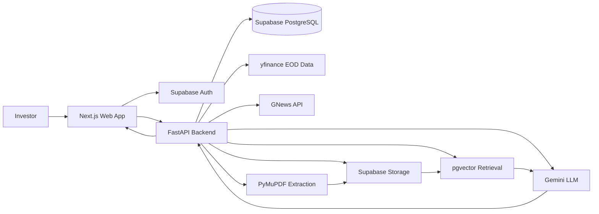

# FINN

## Financial Investment Agent

> A mobile-first investor intelligence workspace that helps investors discover what changed, understand why it matters, and find the right people to call.

[](https://f-inancial-investment-agent-iz1j.vercel.app/)
[](https://drive.google.com/file/d/1AVEyy5tvWXEJcnYiwfVHr1yoFWsxk-ja/view?usp=sharing)

**Live application:** [f-inancial-investment-agent-iz1j.vercel.app](https://f-inancial-investment-agent-iz1j.vercel.app/)

---

## What is FINN?

FINN is an AI-powered investor research assistant built around three workflows:

| Workflow | Investor question | FINN’s answer |
|---|---|---|
| **Push** | What deserves my attention? | Finds companies and signals worth investigating. |
| **Pull** | What is actually happening inside a company? | Builds cited research from annual reports and earnings-call transcripts. |
| **Network** | Who can help me understand this company? | Finds relevant contacts using explainable matching. |

FINN is designed for investors who want concise decision support without losing the underlying evidence.

---

## Explore FINN

### 1. Push — Companies to Look For

The Push dashboard is FINN’s discovery layer.

It uses stored end-of-day NSE/BSE data to identify companies showing notable price movements and surfaces them as market-radar candidates.

Each candidate can be:

- Researched immediately.
- Added to the portfolio.
- Compared with existing holdings.
- Opened in the market dashboard.

The Today page also contains:

- Live source-backed signals.
- “Why this signal matters” explanations.
- Portfolio expansion and company management.
- Dark mode.
- Mobile section navigation.
- End-of-day market discovery.

> Push is designed to reduce the time between noticing a market movement and deciding whether it deserves deeper research.

---

### 2. Pull — Primary-Source Company Research

Pull is FINN’s on-demand research workflow.

Enter an NSE or BSE ticker such as:

```text
TCS
INFY
RELIANCE
HDFCBANK
```

FINN retrieves the company’s loaded primary-source documents and presents:

- Research summary.
- Financial snapshot.
- Multi-year trajectory.
- Balance sheet.
- Cash quality.
- Management guidance.
- Narrative versus numbers.
- Bull and bear scenarios.
- Relevant network contacts.

The research view includes charts for comparable financial metrics and clear source labels.

Every insight is classified as one of:

| Status | Meaning |
|---|---|
| **Verified** | Directly supported by a source document. |
| **Calculated** | Derived deterministically from verified figures. |
| **Interpreted** | Gemini’s analysis of cited source excerpts. |
| **Unavailable** | The loaded documents do not establish the requested fact. |
| **Synthetic demo** | Fixture data used only for interface demonstration. |

News is shown separately as context and is deliberately excluded from Pull analysis.

---

### 3. Network — Find Who Can Help

The Network layer connects company research with people intelligence.

FINN currently supports:

- Manual contact entry.
- CSV contact upload.
- Skill and sector matching.
- Employer-overlap matching.
- Relevance scoring.
- Explainable match evidence.
- Top contacts embedded inside research.
- Full network view for all contacts.

Example CSV headers:

```csv
name,role,company,sector,skills,linkedin_url,relationship,notes
```

The Research view displays only the top few relevant contacts to keep the page focused. The full set is available through the Network view.

LinkedIn OAuth support is optional and disabled by default because first-degree connection access requires separate LinkedIn permissions.

---

### 4. News — Contextual Market Awareness

The News view uses GNews to provide current market context.

News can help answer:

- What is being discussed about a company today?
- Are there recent events requiring investigation?
- Is a market move connected to a public announcement?

News is clearly marked as contextual and is never treated as primary evidence inside Pull research.

```text
News informs attention.
Annual reports and transcripts support analysis.
```

---

### 5. Ask FINN — Source-Grounded AI Assistant

Ask FINN allows natural-language questions about:

- A portfolio.
- A company.
- Recent financial performance.
- Management guidance.
- Disclosed risks.
- Cash conversion.
- Revenue and margin trends.

Example prompts:

```text
What are the most important developments in my portfolio today?

Compare the last four quarters of revenue for TCS.

What did management promise in the last earnings call?

Did the company achieve its guided growth?

What are the biggest risks disclosed in the annual report?
```

The assistant uses annual-report and earnings-call transcript chunks loaded into Supabase. It is designed to say when the available sources do not support an answer.

---

## What makes FINN an agent?

FINN is more than a static dashboard because it combines:

1. **Data retrieval**  
   Fetches market data, news, documents, and network records.

2. **Source filtering**  
   Separates primary research documents from contextual news.

3. **Document processing**  
   Extracts page-aware text from annual reports and transcripts.

4. **Grounded reasoning**  
   Sends trusted document excerpts to Gemini for interpretation.

5. **Actionable workflows**  
   Lets users research, add companies, add contacts, and ask follow-up questions.

6. **Explainability**  
   Shows provenance, evidence state, citations, and limitations.

Instead of using a complex autonomous-agent framework, FINN uses reliable, observable workflows with clear boundaries between retrieval, analysis, and presentation.

---

## Architecture



### Frontend

- Next.js
- TypeScript
- Responsive mobile-first UI
- Dark mode
- Vercel deployment

### Backend

- Python
- FastAPI
- Document ingestion
- Market ingestion
- News integration
- Network matching
- Gemini orchestration
- Render deployment

### Data layer

- Supabase Auth
- Supabase PostgreSQL
- pgvector
- Supabase Storage
- Page-aware document chunks

### External services

- Gemini for source-grounded analysis.
- yfinance for end-of-day market data.
- GNews for contextual news.
- Optional LinkedIn OAuth for approved connection access.

---

## Evidence flow

```text
Annual report / transcript
          ↓
PDF extraction with PyMuPDF
          ↓
Page-aware document chunks
          ↓
Supabase Storage + PostgreSQL
          ↓
Relevant source retrieval
          ↓
Gemini interpretation
          ↓
Cited research cards
```

FINN does not send news articles into Pull analysis. This preserves the distinction between:

- What a company officially reported.
- What management said.
- What the market is currently discussing.
- What FINN inferred from the evidence.

---

## Project structure

```text
.
├── api/
│   ├── main.py
│   ├── auth.py
│   ├── db.py
│   ├── ingest.py
│   ├── ingest_documents.py
│   ├── ingest_market.py
│   ├── document_fetcher.py
│   ├── research_service.py
│   ├── network_service.py
│   ├── linkedin_service.py
│   ├── news.py
│   ├── llm.py
│   ├── requirements.txt
│   └── .env
│
├── web/
│   ├── app/
│   ├── lib/
│   ├── package.json
│   └── .env.local
│
├── data/
│   ├── sources/
│   └── synthetic_network_contacts.csv
│
├── supabase/
│   ├── schema.sql
│   ├── auth_network_migration.sql
│   └── alert_preferences_migration.sql
│
└── docs/
    └── architecture.md
```

---

## Run FINN locally

### Backend

```bash
cd api
python3 -m venv FIAenv
source FIAenv/bin/activate
pip install -r requirements.txt
PYTHONPATH=. uvicorn main:app --reload --port 8000
```

The API will run at:

```text
http://127.0.0.1:8000
```

Test it:

```bash
curl http://127.0.0.1:8000/health
```

### Frontend

Open a second terminal:

```bash
cd web
npm install
npm run dev
```

Open:

```text
http://localhost:3000
```

---

## Environment variables

### Backend: `api/.env`

```env
SUPABASE_URL=https://your-project.supabase.co
SUPABASE_PUBLISHABLE_KEY=your-anon-or-publishable-key
SUPABASE_SECRET_KEY=your-service-role-or-secret-key
SUPABASE_STORAGE_BUCKET=source-documents

GEMINI_API_KEY=your-gemini-key
GEMINI_MODEL=gemini-2.5-flash

GNEWS_API_KEY=your-gnews-key

FINN_CORS_ORIGINS=http://localhost:3000
LINKEDIN_CONNECTIONS_ENABLED=false
```

### Frontend: `web/.env.local`

```env
NEXT_PUBLIC_API_BASE_URL=http://127.0.0.1:8000
NEXT_PUBLIC_SUPABASE_URL=https://your-project.supabase.co
NEXT_PUBLIC_SUPABASE_PUBLISHABLE_KEY=your-anon-or-publishable-key
```

Never expose these frontend-side:

```env
SUPABASE_SECRET_KEY
GEMINI_API_KEY
GNEWS_API_KEY
```

---

## Supabase setup

Run the following in the Supabase SQL Editor:

```text
supabase/schema.sql
supabase/auth_network_migration.sql
supabase/alert_preferences_migration.sql
```

Create a private Storage bucket named:

```text
source-documents
```

Seed the supported company universe:

```bash
cd api
source FIAenv/bin/activate
PYTHONPATH=. python seed_supabase.py
```

Check the connection:

```bash
PYTHONPATH=. python check_supabase.py
```

---

## Ingest a primary-source document

Store downloaded documents locally in:

```text
data/sources/
```

Then ingest a report:

```bash
cd api
source FIAenv/bin/activate

PYTHONPATH=. python ingest_documents.py \
  --ticker TCS \
  --annual-report /absolute/path/tcs-annual-report.pdf \
  --annual-report-url https://source.example/annual-report.pdf \
  --provenance verified
```

After ingestion:

```text
GET /research/TCS
```

will use the stored annual-report and transcript chunks instead of synthetic demo fixtures.

---

## API endpoints

| Endpoint | Purpose |
|---|---|
| `GET /health` | Backend health check |
| `GET /research/{ticker}` | Primary-source company research |
| `GET /news` | Contextual GNews search |
| `GET /market` | Stored market rows |
| `POST /market/refresh` | Refresh end-of-day market data |
| `GET /opportunities` | Companies to look for |
| `GET /digest` | Push signal feed |
| `GET /network/people` | Network contacts |
| `GET /portfolio/companies` | Tracked portfolio |
| `POST /chat` | Ask FINN |
| `POST /portfolio/companies` | Add a company |

---

## Deployment

### Backend on Render

```text
Root Directory: api
Build Command: pip install -r requirements.txt
Start Command: uvicorn main:app --host 0.0.0.0 --port $PORT
Health Check Path: /health
```

Required Render variables:

```env
SUPABASE_URL
SUPABASE_PUBLISHABLE_KEY
SUPABASE_SECRET_KEY
SUPABASE_STORAGE_BUCKET
GEMINI_API_KEY
GEMINI_MODEL
GNEWS_API_KEY
FINN_CORS_ORIGINS
```

### Frontend on Vercel

```text
Root Directory: web
Build Command: npm run build
Install Command: npm install
```

Required Vercel variables:

```env
NEXT_PUBLIC_API_BASE_URL=https://your-render-api.onrender.com
NEXT_PUBLIC_SUPABASE_URL=https://your-project.supabase.co
NEXT_PUBLIC_SUPABASE_PUBLISHABLE_KEY=your-public-key
```

After deployment, add the Vercel domain to:

```env
FINN_CORS_ORIGINS
```

Example:

```env
FINN_CORS_ORIGINS=https://your-app.vercel.app
```

---

## Suggested demo journey

Try this sequence during a demo:

1. Open **Today** and show the companies-to-look-for radar.
2. Expand the portfolio card.
3. Open **Market** and show price trends.
4. Select a company and open **Research**.
5. Walk through the summary and financial snapshot.
6. Show the trajectory and balance-sheet charts.
7. Explain the evidence and interpretation labels.
8. Open the Network section inside research.
9. Open the full Network view.
10. Search contextual News.
11. Ask FINN a question about company guidance or risk.
12. Toggle dark mode and show the mobile navigation drawer.

---

## Design principles

### Evidence before interpretation

FINN separates source-backed facts from AI-generated analysis.

### Context without contamination

News can influence attention but does not become primary research evidence.

### Explainable network matching

Every contact match includes a reason, such as employer overlap, sector relevance, or skill similarity.

### Mobile-first interaction

Important workflows remain usable on small screens through:

- Responsive cards.
- Compact market rows.
- Mobile section drawer.
- Auto-scroll to signal explanations.
- Touch-friendly controls.

### Free-tier practicality

The prototype favors:

- Supabase free-tier storage and database.
- Render for the Python API.
- Vercel for the Next.js frontend.
- Scheduled or manual ingestion over complex orchestration.

---

## Known limitations

- Market data is end-of-day rather than intraday.
- Yahoo Finance may rate-limit requests.
- LinkedIn first-degree import requires separate approval.
- News is contextual and not used for Pull analysis.
- Some companies may not have complete annual-report or transcript coverage.
- Gemini availability may vary during periods of high demand.
- Synthetic fixtures remain available only as explicitly labeled demo fallbacks.
- The prototype is not investment advice.

---

## Roadmap

- Scheduled daily market ingestion.
- Automated annual-report discovery.
- Earnings-call transcript ingestion.
- More robust document deduplication.
- Improved financial metric normalization.
- Better portfolio-level comparisons.
- Background jobs for Push signal generation.
- Approved LinkedIn first-degree connection import.
- Production monitoring and observability.
- Stronger tenant isolation and row-level security.

---

## Final note

FINN is built to make investor research faster without hiding uncertainty.

It helps users move from:

```text
What changed?
```

to:

```text
Why does it matter?
```

to:

```text
What evidence supports it?
```

to:

```text
Who can help me understand it better?
```

FINN is a research assistant, not an investment adviser. Always verify important decisions against the original source documents.
